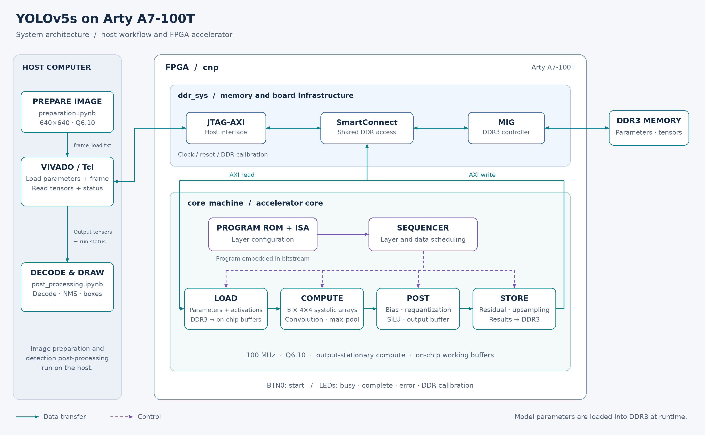
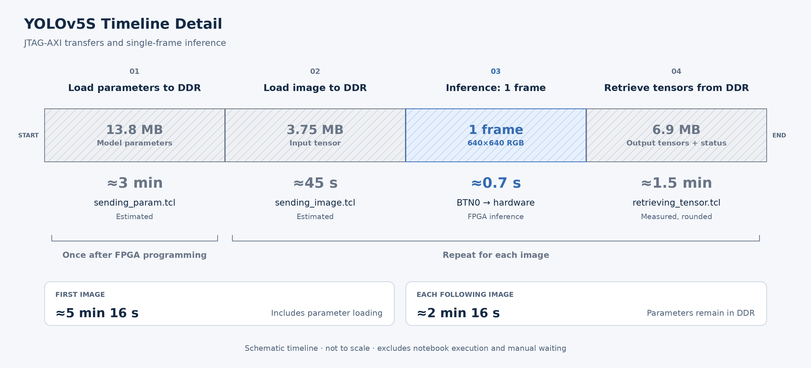

# YOLOv5s on Arty A7-100T

This repository demonstrates object detection with YOLOv5s on an Arty A7-100T FPGA. A Jupyter notebook prepares an input image, Vivado Tcl scripts transfer the model parameters and image to the board through JTAG-AXI, and a second notebook decodes the output tensors and draws the detections.

The repository contains a prebuilt FPGA bitstream and its hardware probes file. It does not include the FPGA RTL source or a Vivado project used to build the bitstream.

## Repository contents

| Path | Description |
|---|---|
| `bit_files/cnp.bit` | Prebuilt FPGA bitstream |
| `bit_files/cnp.ltx` | Hardware probes file used with the bitstream in Vivado Hardware Manager |
| `preparation.ipynb` | Loads an image, letterboxes it to 640×640, converts it to Q6.10 fixed point, and creates the FPGA input files |
| `sending_param.tcl` | Loads model parameters into DDR through JTAG-AXI |
| `sending_image.tcl` | Transfers the prepared image to the board through JTAG-AXI |
| `retrieving_tensor.tcl` | Waits for inference to finish and saves the status and three output tensors |
| `post_processing.ipynb` | Decodes output tensors, applies non-maximum suppression, and saves detections |
| `params/load_weights.txt` | Fused, quantized YOLOv5s model parameters in the accelerator's memory layout |
| `params/yolov5s_meta.json` | Class names, strides, anchors, and parameter layout metadata |
| `assets/` | System architecture and demo timeline diagrams in PNG and SVG formats |
| `images/` | Place input images here |
| `results/` | Destination for annotated images and detection text files |

## About the system

The system implements a YOLOv5s accelerator on the Arty A7-100T, with a 100 MHz core and 16-bit Q6.10 fixed-point data. A custom layer-level instruction set and sequencer coordinate the LOAD, COMPUTE, POST, and STORE stages. The compute engine uses eight 4×4 output-stationary systolic arrays. POST handles bias, requantization, and SiLU; STORE handles residual addition and upsampling as configured.

Model parameters and input images are loaded into DDR3 through JTAG-AXI. The accelerator reads data from DDR3 and writes intermediate tensors and final outputs back to memory. Image preparation, detection decoding, non-maximum suppression, and visualization run on the host computer.



DDR3 is a separate chip on the same Arty A7-100T board. The FPGA boundary in the diagram represents the FPGA chip.

This release provides the prebuilt bitstream and host-side demo workflow. The RTL sources and Vivado project are retained for ongoing research.

## Requirements

- Digilent Arty A7-100T board connected over JTAG.
- Vivado Hardware Manager with access to the programmed device and its JTAG-AXI hardware interface.
- Python with Jupyter Notebook, NumPy, and Pillow (PIL).

The notebooks use Python's standard library in addition to NumPy, Pillow, and the Jupyter/IPython environment. No Ultralytics Python package is required for post-processing.

## Run the demo



Parameter loading runs once after FPGA programming; the remaining stages repeat for each image. Upload times are estimates, and tensor retrieval time is rounded from a previous measurement. The timeline excludes notebook execution and manual waiting.

Run the Tcl commands in the Vivado Tcl Console. Replace `/path/to/YOLO-V5S-FPGA-Workspace-Implementation` in the commands below with the full path to this repository on your computer. Run notebook cells in order from the repository root so the relative file paths resolve correctly. The demo uses four board LEDs:

| Package pin | Board LED | Meaning |
|---|---|---|
| H5 | LED4 | Inference is running |
| J5 | LED5 | Inference completed successfully |
| T9 | LED6 | Error occurred |
| T10 | LED7 | MIG DDR calibration |

1. **Program the FPGA.** In Vivado Hardware Manager, connect to the Arty A7-100T, program it with `bit_files/cnp.bit`, and provide `bit_files/cnp.ltx` as the probes file. Refresh the hardware device if needed so Vivado exposes the JTAG-AXI interface.

2. **Load model parameters first.** In the Vivado Tcl Console, run:

   ```tcl
   source -notrace /path/to/YOLO-V5S-FPGA-Workspace-Implementation/sending_param.tcl
   ```

   The script transfers `params/load_weights.txt` to DDR and compares every 50th transaction with a readback. DDR contents are lost when the FPGA is reprogrammed, so run this step again after each reprogramming.

3. **Prepare the image.** Put a JPG, PNG, or WebP image in `images/`. In `preparation.ipynb`, set `IMAGE_NAME` to that filename and run the notebook cells in order. The notebook scales the image while preserving its aspect ratio, centers it on a 640×640 canvas with gray padding, converts RGB pixels to Q6.10, and writes `frame_load.txt` and `frame_meta.json` in the repository root. To use a different image, update `IMAGE_NAME` and run the notebook again.

   **Do not delete `frame_load.txt` before sending the image.** It is the image data that the Tcl script transfers to the board.

4. **Send the image to DDR.** In the Vivado Tcl Console, run:

   ```tcl
   source -notrace /path/to/YOLO-V5S-FPGA-Workspace-Implementation/sending_image.tcl
   ```

   The script checks that the prepared frame has the expected length, transfers it to DDR, and performs sampled readback verification. Wait until the script reports that the image has been sent.

5. **Start inference.** Press BTN0 after the parameters and image have been loaded. LED4 turns on while inference is running. Wait until LED4 turns off and LED5 turns on to confirm successful completion. LED6 indicates an error; LED7 indicates MIG DDR calibration.

6. **Retrieve the output.** After LED5 turns on, run this in the Vivado Tcl Console:

   ```tcl
   source -notrace /path/to/YOLO-V5S-FPGA-Workspace-Implementation/retrieving_tensor.tcl
   ```

   The script reads the completion status and output tensors, then writes `status.txt`, `det0.txt`, `det1.txt`, and `det2.txt` in the repository root.

7. **Decode and save detections.** Run `post_processing.ipynb` from the repository root. It reads the status and tensors, performs YOLOv5-style decoding and non-maximum suppression, then saves `<image>_result.jpg` and `<image>_detections.txt` under `results/`.

**Do not delete required `.txt` files before post-processing.** If `frame_load.txt` is missing, rerun `preparation.ipynb`; if an output file (`status.txt`, `det0.txt`, `det1.txt`, or `det2.txt`) is missing, rerun `retrieving_tensor.tcl` while the FPGA still holds the inference output. If parameters or image data need to be reloaded, rerun the corresponding transfer Tcl script. `params/load_weights.txt` is a required model file and must be restored if deleted.

The notebook's post-processing defaults are a confidence threshold of `0.25`, an IoU threshold of `0.45`, and a maximum of 1000 detections. The reported inference latency is measured from FPGA cycle count at 100 MHz; it does not include image preparation, JTAG transfers, tensor retrieval, or post-processing.

## Input and output notes

- Input images may have any dimensions or aspect ratio. The preparation notebook applies a fixed 640×640 letterbox; very small objects or unusually wide images may yield fewer detections.
- `frame_meta.json` records the original image dimensions and letterbox transform so the post-processing notebook can map boxes back to the original image.
- The three output tensors correspond to detection grids with spatial sizes 80×80, 40×40, and 20×20.
- The results text file contains one detection per line: class ID, class name, confidence score, and bounding-box coordinates `(x1, y1, x2, y2)` in original-image pixels.
- Result files are generated locally. The input preparation and tensor post-processing happen in the notebooks; inference runs on the FPGA.

## Citation

If you use this project, cite it using the metadata in [`CITATION.cff`](CITATION.cff). Also credit the original [Ultralytics YOLOv5 project](https://github.com/ultralytics/yolov5) for the model and the COCO dataset for its object categories.

## Licenses and attribution

This repository combines original work with model parameters and metadata derived from third-party work. Different files have different licensing terms.

| Part | Source | License / terms |
|---|---|---|
| Bitstream (`bit_files/`), Tcl scripts, notebooks, and documentation | Original work by the author | MIT; see [LICENSE](LICENSE) |
| Model parameters (`params/load_weights.txt`) | Derived from the Ultralytics YOLOv5s v7.0 pretrained weights | GPL-3.0; see [`params/LICENSE`](params/LICENSE) |
| Anchors and strides (`params/yolov5s_meta.json`) | YOLOv5s v7.0 model configuration | GPL-3.0; see [`params/LICENSE`](params/LICENSE) |
| Class names (`params/yolov5s_meta.json`) | The 80 object categories of the COCO dataset | See [COCO terms of use](https://cocodataset.org/#termsofuse) |

**The MIT license in this repository does not apply to the model parameters or third-party metadata listed above.**

### Model parameters

The parameter file is derived from the YOLOv5s pretrained checkpoint published by Ultralytics:

- Source code and release: [ultralytics/yolov5, tag v7.0](https://github.com/ultralytics/yolov5/tree/v7.0), commit `915bbf294bb74c859f0b41f1c23bc395014ea679`.
- Checkpoint: [yolov5s.pt from the v7.0 release](https://github.com/ultralytics/yolov5/releases/download/v7.0/yolov5s.pt).
- License for that release: [GNU General Public License v3.0](https://github.com/ultralytics/yolov5/blob/v7.0/LICENSE). Ultralytics has since moved YOLOv5 to AGPL-3.0 and also offers [commercial licenses](https://ultralytics.com/license).

Changes made to produce `params/load_weights.txt`:

1. Each convolution was fused with its batch-normalization layer.
2. Weights and biases were quantized to 16-bit fixed point (Q6.10).
3. Values were reordered into the accelerator's memory layout and written as hexadecimal JTAG-AXI write transactions.

The model was not retrained or fine-tuned. The parameter file and values taken from the YOLOv5 configuration are distributed under GPL-3.0, as the original weights were. If you redistribute or modify them, GPL-3.0 applies to those files. Contact Ultralytics if you need the weights under other terms.

The bitstream does not contain the model parameters. They are loaded into DDR memory at run time, so the bitstream itself is the author's original work under MIT.

### Credit and affiliation

YOLOv5 was created and is maintained by [Ultralytics](https://github.com/ultralytics/yolov5). The COCO dataset is described in Lin et al., *Microsoft COCO: Common Objects in Context*, ECCV 2014.

This project is independent. It is not affiliated with, sponsored by, or endorsed by Ultralytics or the COCO Consortium. “YOLOv5” and “Ultralytics” are used only to identify the original model.
