# FPGA Output Error Comparison

FPGA Q6.10 outputs were compared with **Conv + BatchNorm fused YOLOv5s v7.0 FP32** on **15 COCO val2017 images**. All 15 captures were included, covering **32,130,000 valid output values** across the three detection heads, before sigmoid and NMS.

**Error = FPGA − FP32.** The combined results were:

- **MAE:** 0.025099
- **RMSE:** 0.039982
- **Maximum absolute error:** 1.525083
- **Mean signed error:** -0.000173

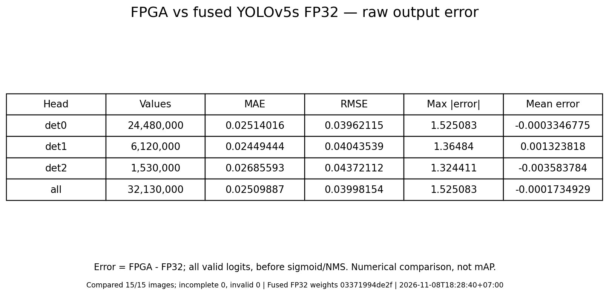

Average absolute error was similar across the three heads: **0.024494–0.026856**. `det2` had the highest MAE and RMSE, while `det0` contained the largest individual error. The near-zero combined signed mean indicates little net offset; individual deviations remain visible in the MAE and RMSE.

The maximum error was substantially larger than the average error, showing that some output values differed considerably more than the overall mean suggests.

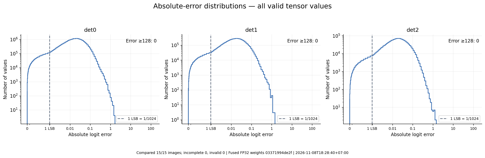

Per-image MAE ranged from **0.018650** for `000000027620.jpg` to **0.039140** for `000000107554.jpg`. The largest individual deviation, **1.525083**, also occurred in `000000107554.jpg`.

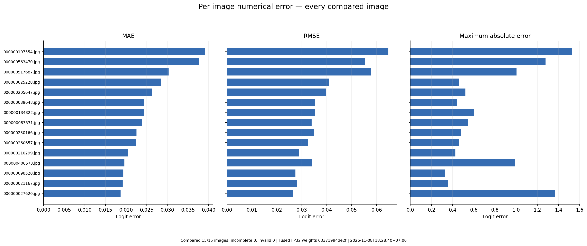

These values are raw-logit differences, not detection-accuracy percentages. They describe the combined numerical difference between this fixed-point implementation and FP32 on the evaluated sample. Detection mAP requires a separate evaluation against ground-truth annotations.

Spatial error results for all 15 images

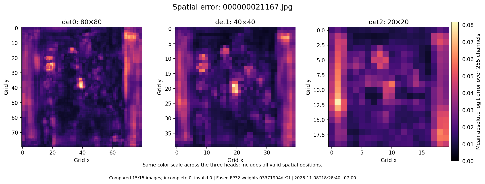

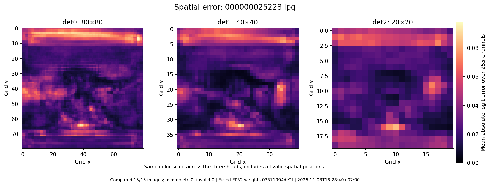

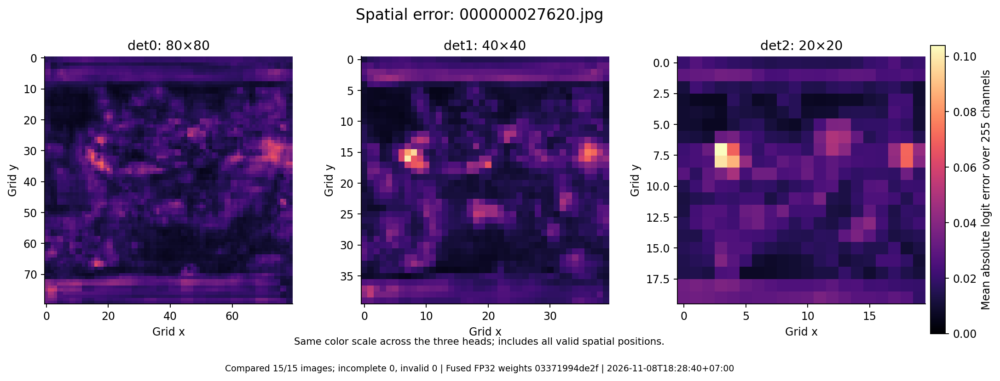

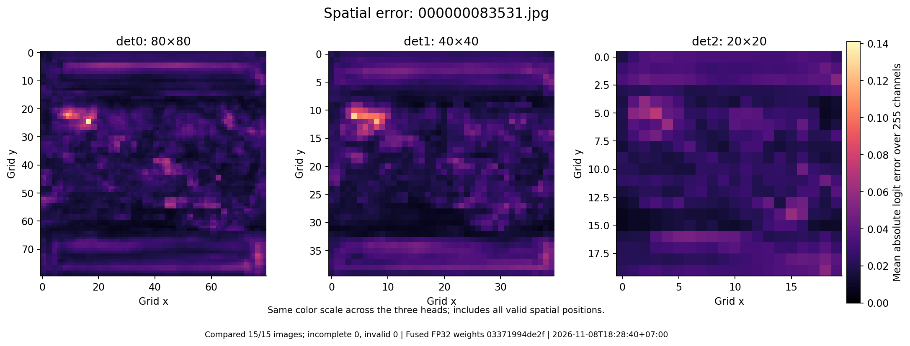

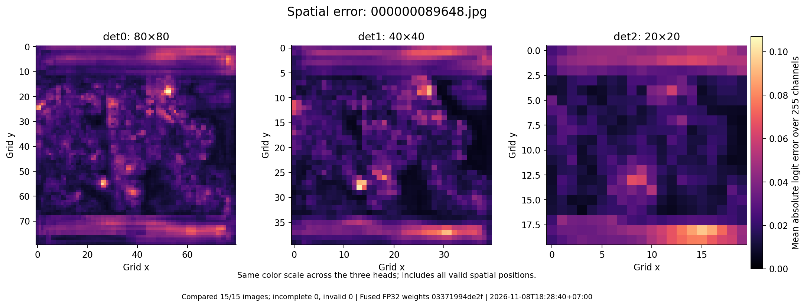

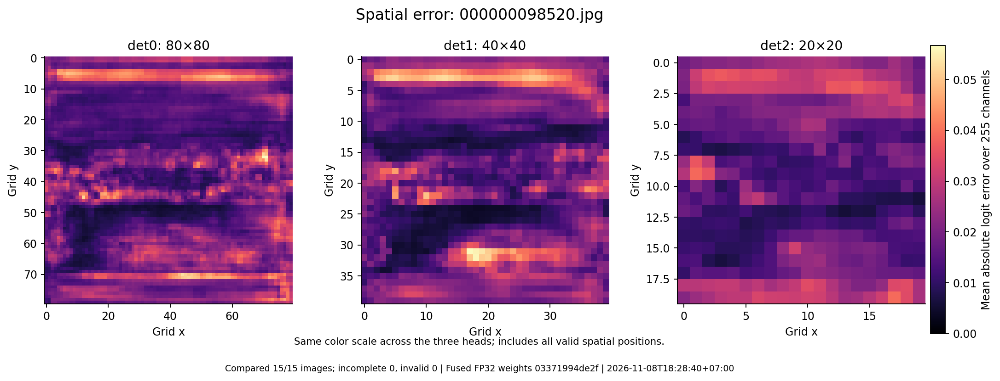

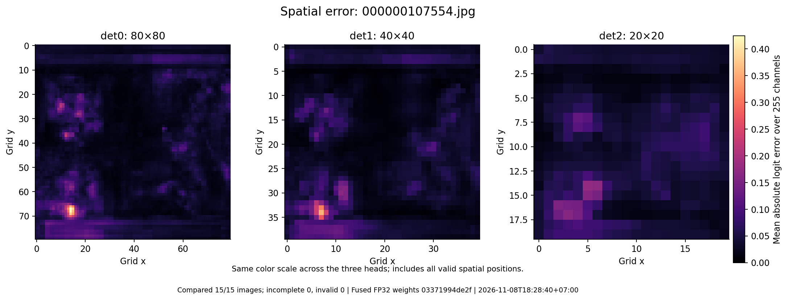

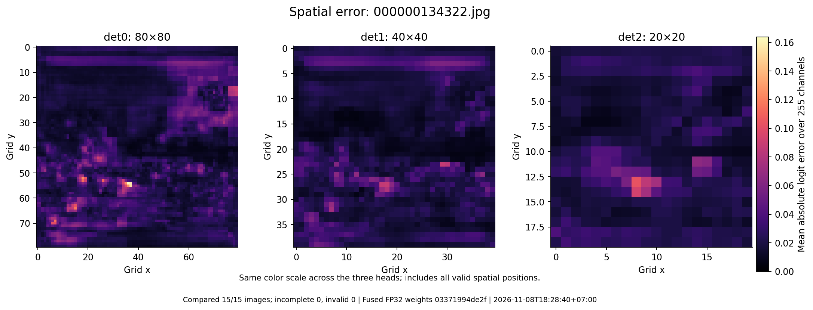

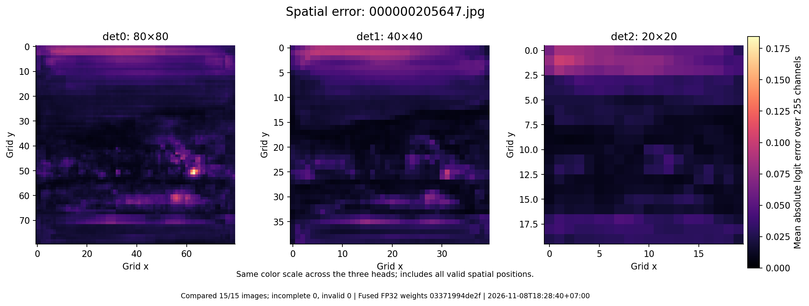

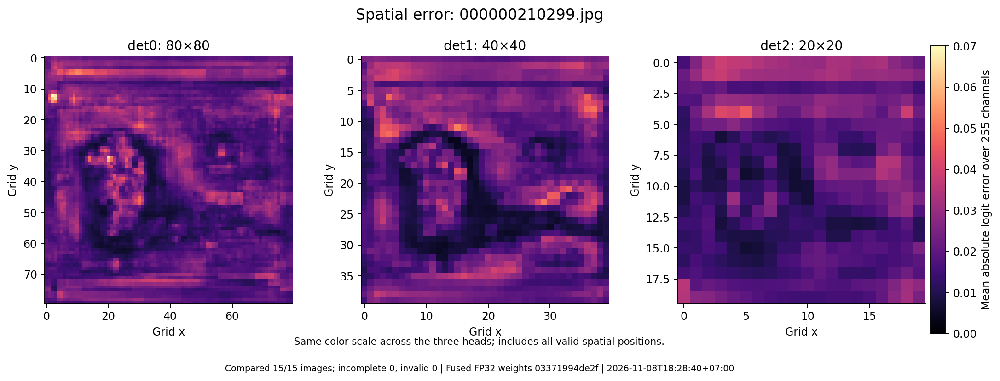

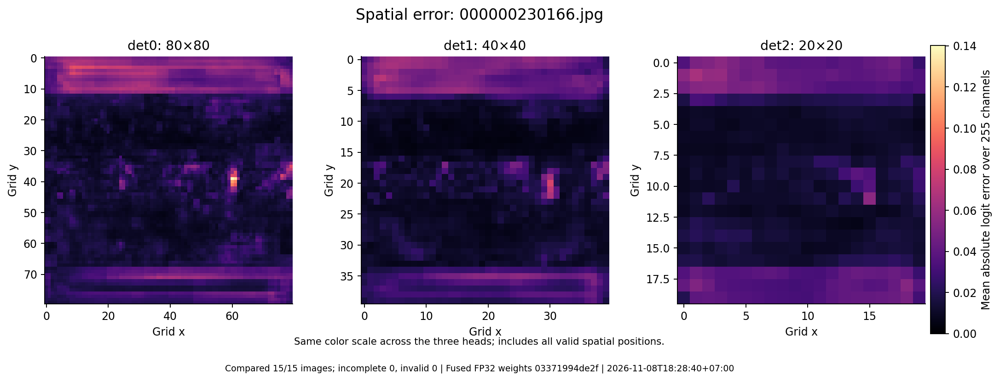

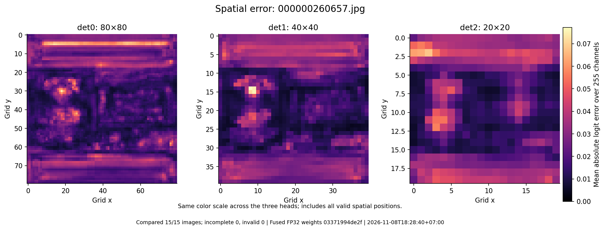

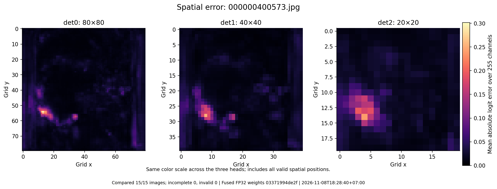

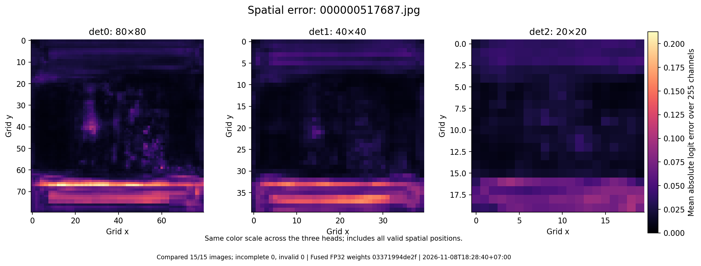

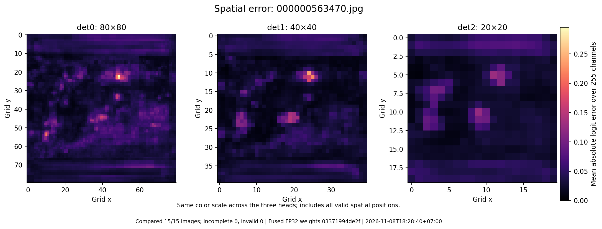

